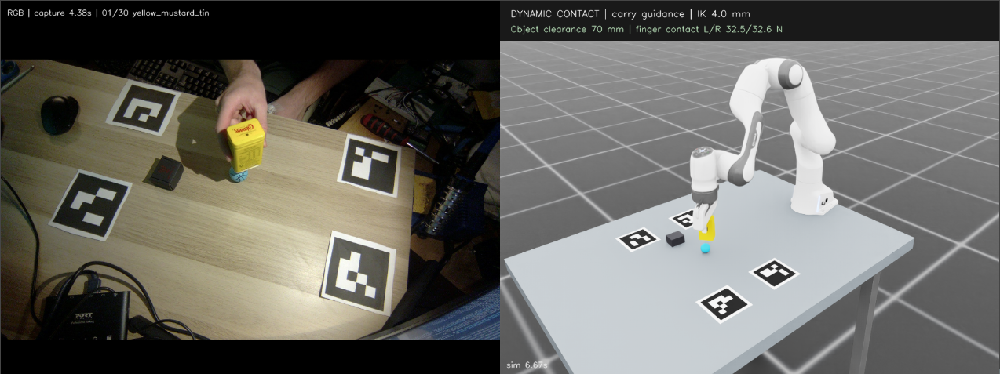

# Desk2Isaac

Human pick-and-place demonstrations, retargeted to a Panda arm in Isaac Lab.

I recorded 30 overhead RGB-D clips on my desk using an Orbbec Gemini 2. The system extracts the object's start, destination, carry path and upright yaw, then executes a physical grasp in simulation. A separate supervised-learning experiment asks whether RGB crops can recover approximate pose without reading depth at prediction time.

## Watch

Paired recordings showing my teaching video beside the Isaac Lab simulation:

- **Black box:** [docs/assets/videos/023_black_box.mp4](docs/assets/videos/023_black_box.mp4)
- **Blue sphere:** [docs/assets/videos/028_blue_sphere.mp4](docs/assets/videos/028_blue_sphere.mp4)
- **Mustard tin:** [docs/assets/videos/030_yellow_mustard_tin.mp4](docs/assets/videos/030_yellow_mustard_tin.mp4)

The comparison aligns the recorded carry frames with the robot's guidance phase. Robot approach and settling take additional time; this is not equal wall-clock playback.



Left: my recorded demonstration. Right: the simulated Panda carrying the tin, with the same marker layout and stationary objects for reference.

## Results

- **Robot replay:** 29/30 tasks passed contact, lift, release, settling and 25 mm placement checks. All 20 cuboid tasks finished within 5 mm and passed the yaw checks. The sphere often rolled after release; one sphere task failed.
- **RGB experiment:** the two-hour run reached 5.24 mm median XYZ disagreement with the approximate depth teacher on eight validation clips. Carry-phase disagreement fell from 65.43 mm for a rest-height baseline to 14.69 mm. Box yaw remained poor.

These are different experiments. The robot uses the RGB-D trajectory, not the learned RGB predictions. Simulation placement error is measured against extracted targets, not independently measured real-world ground truth. The eight ML validation clips were used for model selection; there is no independent test set.

The main system is geometric demonstration retargeting with a scripted controller. It is not a trained robot policy, VLA, RL system or world model.

## Run

Start with the CPU checks. No camera, SAM model or simulator is needed:

```bash
python3 -m venv .venv
source .venv/bin/activate
python -m pip install -e '.[dev]'
python -m pytest -q
python scripts/check_submission.py
python scripts/replay_demo.py --dry-run
```

With a working Isaac Lab environment, run the three included real-data tasks sequentially:

```bash
export ISAAC_PYTHON=/path/to/isaaclab/environment/bin/python
python scripts/replay_demo.py --out outputs/demo
```

For RGB prediction, use the included pose head and crops in a separate ML environment. The first run downloads the frozen ImageNet encoder; it does not need depth, the camera or SAM:

```bash
python -m pip install -e '.[ml]'
python scripts/predict_rgb_student.py \
  --inputs examples/rgb_supervision/inputs.json \
  --checkpoint examples/models/rgb_long_head.pt \
  --device cpu --out outputs/rgb_predictions.json
python scripts/evaluate_rgb_student.py \
  --manifest examples/rgb_supervision/training_manifest.json \
  --predictions outputs/rgb_predictions.json \
  --out outputs/rgb_evaluation --plots
```

[Setup](docs/setup.md) covers simulator prerequisites, capture, SAM installation and training commands. Use a fresh output path for each run.

## Read

| Document | Contents |
| --- | --- |
| [Pipeline sheet](docs/pipelines.md) | Both workflows, technical details and plain-English explanations |
| [Results and evidence](docs/results.md) | Measurements, failure cases, figures and source reports |
| [Data](docs/data.md) | Personal collection, included files, splits and missing raw data |
| [RGB experiment](docs/rgb_perception.md) | Architecture, supervision, augmentation and training recipes |
| [Project summary](docs/project_summary.md) | Decisions, scope and remaining submission checks |

`src/` contains the processing and control modules; `scripts/` contains the command-line entry points; `tests/` checks the data, geometry and controller contracts. `examples/` contains three prepared robot tasks, 3,007 RGB crops with separate teacher labels, and two compact trained heads. `evidence/` contains the full-review summaries and both ML run reports.

## Design Choices

Colour thresholds were useful for the first prototype, but the dark box's shadow corrupted the mask. Prompted SAM 2 tracking was much more reliable. I kept the metric geometry explicit so that a good-looking mask could still be rejected when its depth or shape was implausible.

I used Isaac Lab because I had worked with it before and wanted to check an actual contact grasp. The manipulated object is free under gravity, not attached to the gripper or teleported along the demonstration. The other objects and markers are visual references, not collision obstacles.

Once the cuboid replay was reliable, I focused the learning experiment on perception. The small, fixed-camera dataset was enough to demonstrate depth-supervised learning, but not enough to justify replacing the working tracker or claiming generalisation to a new desk.

Original code is [MIT licensed](LICENSE). Recorded examples have [separate terms](DATA_TERMS.md); downloaded dependencies retain their [upstream licences](THIRD_PARTY.md).
