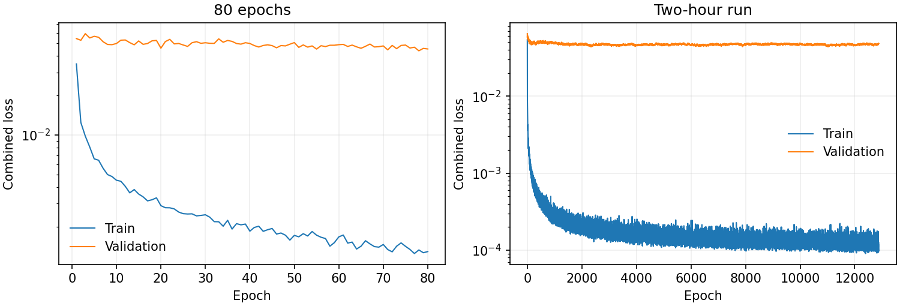
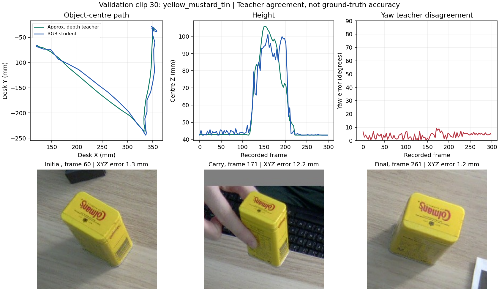

# Results and Evidence

The robot review and the RGB learning experiment answer different questions. The first checks physical execution of extracted tasks. The second measures how well a small RGB model agrees with an approximate depth tracker.

This is a screenshot from the paired review, not a generated illustration. The Panda holds a free rigid body under gravity. Matching markers and stationary objects make the coordinate relationship easier to inspect.

## Physical Robot Review

All 30 retained demonstrations completed a yaw-enabled review. Each object has ten clips. The manipulated object's pose was commanded **zero times during execution**; contact and finger actuation carried it.

| Object | Pick/place passes | Within 5 mm | Median final XY error | Maximum final XY error | Median final yaw error |
| --- | --- | --- | --- | --- | --- |
| Black box | 10/10 | 10/10 | 1.13 mm | 1.24 mm | 0.04 degrees |
| Blue sphere | 9/10 | 0/10 | 16.98 mm | 25.04 mm | Not defined |
| Mustard tin | 10/10 | 10/10 | 0.79 mm | 2.41 mm | 0.39 degrees |

Overall: **29/30 pick/place passes**, **20/30 within 5 mm**, and **20/20 cuboid pick/place-plus-yaw passes**. The pass criterion was final XY error at most 25 mm plus contact, lift, slip, release and settling checks. The 5 mm figure is an additional diagnostic, not the criterion used to classify success. Yaw uses the shape axis modulo 180 degrees; its tolerance is 10 degrees, with final upright tilt at most 15 degrees.

Carry-path tracking is less precise than final placement. The median per-clip 95th-percentile object/reference error was 8.32 mm for the box, 7.89 mm for the sphere and 8.72 mm for the tin. The reference includes robot carry-clearance adjustments; it is not the unmodified human path.

**Failure:** sphere clip 18 ended 25.04 mm from the extracted goal. Spheres often moved after opening the fingers: all ten missed the tighter 5 mm diagnostic despite generally valid contact grasps. This is a release/settling limitation, not evidence that the box or tin is attached to the gripper.

**What these numbers do not show:** sub-millimetre physical-camera accuracy, performance on unseen robot tasks, general manipulation or obstacle avoidance. Targets come from approximate RGB-D geometry. Mass (0.1 kg), friction (0.8) and gripper effort limit (40 N per finger) were assumed. Marker scale has an unresolved discrepancy: a rough 570-580 mm ruler estimate did not fully match the saved depth-based calibration. Stationary scene objects have no collisions.

Evidence: [30-clip summary](../evidence/robot/summary.json), [playlist record](../evidence/robot/run.json), and [per-clip reports](../evidence/robot/clips/). Per-clip public reports omit dense frame telemetry; hashes identify the unchanged local originals. The summary retains all 30 outcomes, including the failure.

Paired examples: [box](assets/videos/023_black_box.mp4), [sphere](assets/videos/028_blue_sphere.mp4), [tin](assets/videos/030_yellow_mustard_tin.mp4). Recorded carry frames follow the corresponding robot guidance phase, pausing during extra controller holds. These are not wall-clock-synchronised live demonstrations.

## RGB Learning Experiment

The held-out batch contains eight clips: five box, two sphere and one tin. It was withheld from gradient fitting, **but used to choose the best checkpoint**. It is therefore validation, not an independent test. There are 805 validation frames; neighbouring frames are correlated, not 805 independent trials.

XYZ error below is three-dimensional centre disagreement with approximate observed depth teachers, in millimetres:

| Validation metric | RGB centroid at rest height | 80-epoch student | Two-hour student |
| --- | --- | --- | --- |
| Mean XYZ | 18.52 | 10.83 | 9.07 |
| Median XYZ | 3.46 | 5.86 | 5.24 |
| 95th-percentile XYZ | 79.78 | 33.67 | 32.95 |
| Initial-phase median XYZ | 1.64 | 4.68 | 4.41 |
| Carry-phase median XYZ | 65.43 | 18.24 | 14.69 |
| Final-phase median XYZ | 1.61 | 5.16 | 4.48 |

The student helps most when the object is lifted. The simple rest-height baseline is still better on many stationary frames, including the overall median. The learned model is not uniformly better.

| Object | 80-epoch median XYZ | Two-hour median XYZ | 80-epoch median yaw | Two-hour median yaw |
| --- | --- | --- | --- | --- |
| Black box | 8.05 mm | 6.49 mm | 33.63 degrees | 36.95 degrees |
| Blue sphere | 4.82 mm | 3.74 mm | Not defined | Not defined |
| Mustard tin | 1.96 mm | 2.11 mm | 3.18 degrees | 4.08 degrees |

The longer run improved aggregate positional agreement, but yaw did not improve. The box yaw result is not good enough for robot execution. The tin validation result comes from only one clip.

The two-hour fit completed 12,880 epochs and 643 augmentation refreshes. Its selected checkpoint was epoch 2,322, about 21.9 minutes into fitting. Later training did not improve the checkpoint-selection loss. Training median XYZ was 0.30 mm versus 5.24 mm on validation, showing a substantial generalisation gap.

The recipes differed in learning rate and augmentation refresh as well as duration. This is not a controlled duration-only ablation. Selection minimised a combined position/yaw loss, not XYZ alone; the long run's best combined validation loss was slightly worse than the short run's.

Additional plots: [box](assets/rgb/023_black_box.png), [sphere](assets/rgb/028_blue_sphere.png). These saved plots were produced by a separate CPU inference pass; very small numerical differences from the original GPU-feature reports are expected.

Evidence: [short-run report](../evidence/rgb_short/report.json), [long-run report](../evidence/rgb_long/report.json), [long-run inference evaluation](../evidence/rgb_long/validation/metrics.json), and [source fingerprints](../evidence/provenance.json). Both trained heads and the same crop/label/split bundle are included for rerunning prediction and fitting.

Depth files and teacher labels were blocked during an earlier CPU-only prediction audit of all 805 validation crops. The measured 12.27 seconds included crop I/O but excluded model loading and SAM segmentation; it is not an end-to-end live-system benchmark. The bundled compact head is additionally checked against the original full checkpoint during submission preparation.

**Limits:** fixed camera, known object sizes and identities, cached masks, approximate pseudo-labels, few recording sessions, imbalanced validation objects, and no independent test or learned-pose robot evaluation. Since the physical marker layout moved, no new matching recordings were added. The experiment is retained as a supervised-learning demonstration, not a replacement for the evaluated RGB-D pipeline.

## Submission Checks

Before packaging, all 319 tests passed in the Torch-enabled environment. The relocated CPU suite passed 309 tests with the Torch module skipped. Both compact heads matched every tensor in their original full checkpoints, and 805 long-run validation predictions completed with depth/teacher file opens blocked. The short model also predicted and evaluated all 805 validation frames from the relocated folder.

The three bundled tasks were rerun headlessly from that folder, with rendering enabled. All passed the original physical-grasp checks, with zero execution-time object-pose commands. Reproduced final XY errors were 1.13 mm (box), 21.77 mm (sphere) and 1.39 mm (tin); both cuboids passed yaw checks. Rendered frames were nonblank and changed over time, and lift screenshots were inspected.

These checks used the existing Isaac installation and asset cache; they do not certify a fresh simulator installation. An editable package install was checked with existing dependencies. [Verification record](../evidence/submission_checks.json) preserves the checks and current model/controller fingerprints. It is separate from the original full-review benchmark.
